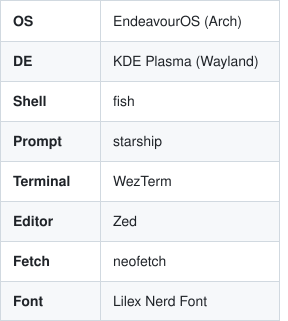
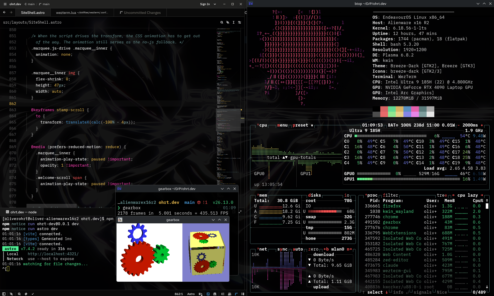
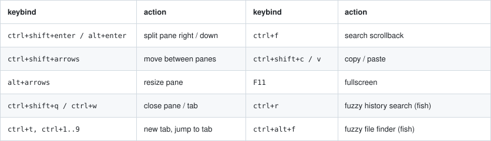

# dotfiles

<p align="center">
<picture><source media="(prefers-color-scheme: dark)" srcset=".github/specs-dark.svg"></picture>
</p>

daily setup is fish shell inside wezterm. wezterm has real splits and tabs built
in so I never ended up needing tmux, and starship handles the prompt and
mostly does nada unless git has something to say. zoxide is the newest
addition and I'm a big fan of, `z dot` beats typing paths manually.
the colors started as me trying to copy btop's default theme into my
terminal, I got them wrong in a brighter direction and liked it better, so
now it's its own palette ([otop](otop.md)) and even btop runs it through a
custom theme. zed is themed to match, same colors same transparency. my
claude code config lives in here too and it has hooks that notice when a
config changes and commit it back, so the repo keeps itself up to date.

everything is a GNU Stow package mirroring `$HOME`.

## Setup

```sh
sudo pacman -S git stow
git clone https://github.com/Lavanic/dotfiles.git ~/dotfiles
cd ~/dotfiles && ./install.sh --packages   # pacman list, paru bootstrap, AUR list, then stows
```

If a real config already exists, stow refuses to overwrite it: move it away
or `stow --adopt --target="$HOME" <pkg>` and diff. Machine-local settings
stay untracked (`~/.gitconfig.local`, `~/.claude/settings.local.json`), and
no ssh, keys, or shell history live here.

The grub theme is the one thing stow can't place (root-owned):

```sh
sudo cp -r system/grub/themes/valhalla /usr/share/grub/themes/
# set GRUB_THEME="/usr/share/grub/themes/valhalla/theme.txt" in /etc/default/grub
sudo grub-mkconfig -o /boot/grub/grub.cfg
```

## Keys

<picture><source media="(prefers-color-scheme: dark)" srcset=".github/keys-dark.svg"></picture>
